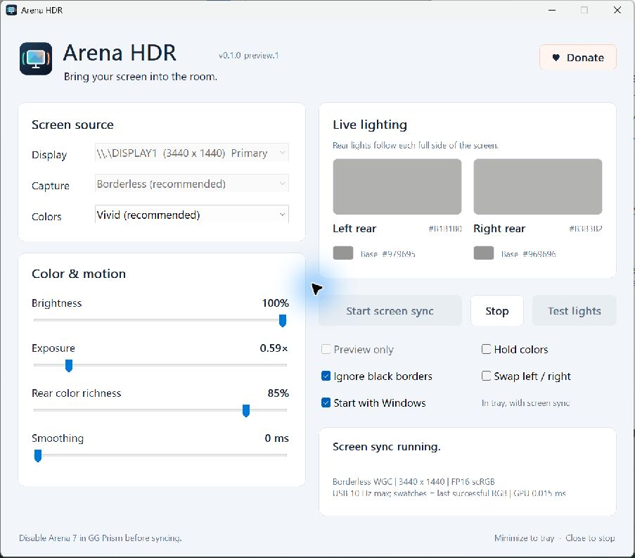

# Arena HDR

**Screen-reactive lighting for SteelSeries Arena 7, with HDR left on.**

A small native Windows app that follows your screen's colors and drives the four Arena 7 lighting zones over USB. The rear lights follow the full left and right sides; the base lights accent the lower part of each side.

**Preview release · Windows x64 · Arena 7 only**



[Support development on Ko-fi](https://ko-fi.com/ilyamezerowsky)

## Get started

1. Extract the portable release ZIP into a writable folder and open **ArenaHDR.exe**. For a source checkout, [build it first](#build-from-source).
2. Connect the Arena 7 speakers by **USB**.
3. In **SteelSeries GG → Engine → Prism**, disable Arena 7 so two lighting controllers do not compete. Prefer this over exiting GG if you use Sonar.
4. Select your display and click **Test lights**. For eight seconds, the left base is red, left rear green, right base blue, and right rear amber. The test ends in soft white.
5. Leave **Borderless** and **Vivid** selected, then click **Start screen sync**. Windows HDR can stay enabled.

Minimize to the system tray; click the tray icon or launch the app again to reopen it. **Stop** or closing the window ends capture and lighting updates. The speakers keep their last color. Re-enable Arena 7 in Prism to return to GG lighting; the app does not read or restore the previous onboard effect.

Settings are saved beside the EXE in `ArenaHDR.ini`. The portable preview is unsigned; no driver or service is installed.

Enable **Start with Windows** to launch in the tray and begin screen sync when you sign in. It is off by default, applies only to your Windows user, and uses your saved display, capture, color, and **Preview only** settings. If the speakers are still connecting, it retries until they are ready or you press Stop. Uncheck the option to remove automatic startup. The option takes effect immediately; lighting settings are saved when you close the app or sign out.

Keep the app in a permanent folder before enabling startup. If you move it, open it from the new location and enable the option again. Disable startup before deleting the portable folder. If you disable Arena HDR in Windows Startup apps, re-enable it there to allow launch at sign-in. Startup uses the current user's [Windows Run entry](https://learn.microsoft.com/en-us/windows/win32/setupapi/run-and-runonce-registry-keys), with no administrator privileges required.

## Make it look right

| Control | What it changes |
|---|---|
| Vivid | Follows prominent saturated colors on each side, avoiding a muddy average of unrelated hues. |
| Bright areas | Favors luminous areas, including white highlights, while still considering their size. |
| Average | Blends the whole region for a softer wash. |
| Brightness | Overall output level for all four lights. |
| Exposure | Scene intensity before highlight compression; 1.00× is the default. |
| Rear color richness | Removes some common white from chromatic rear colors. Default 85%; neutral grays and base lights are unchanged. |
| Smoothing | Transition time; higher values give gentler changes. |
| Ignore black borders | Trims fully dark outer rows/columns, up to a quarter of each edge. |
| Swap left / right | Reverses both speakers' lighting zones. |
| Preview only | Captures colors without sending commands to the speakers. Set it before starting. |
| Hold colors | Freezes and repeats the last colors for comparison. Sampling and adjustments pause until unchecked. |

The large previews represent the rear wall lights. During sync, swatches show the RGB values from the **last successful USB write**; this is not a reading from the LEDs. Preview mode shows computed targets. Wall color, ambient light, and the LEDs affect perceived color. Rear richness is an aesthetic adjustment, not measured hardware calibration.

## Capture and compatibility

Requires **Windows 10 version 2004 or newer / Windows 11**, an x64 PC, and a Direct3D 11 GPU. Borderless Windows Graphics Capture additionally requires Windows build 20348 or newer and capture permission.

- **Borderless** first tries HDR-capable Desktop Duplication, then falls back to Windows Graphics Capture. It requests permission to suppress the yellow capture frame. If Windows prompts for permission, respond directly to that Windows prompt. A denial or system policy can leave the frame visible; the app reports this in its status.
- **Compatibility** uses Windows Graphics Capture with the normal capture border. Another screen-capture app can also cause a border.
- HDR is sampled as floating-point linear scRGB. SDR frames are linearized before processing.
- Protected video or apps excluded from capture can appear black. Arena HDR cannot recover pixels Windows does not expose.
- Dolby Vision metadata is not decoded. Lighting follows Windows' composited pixels; Dolby Vision compatibility is not guaranteed.
- Some exclusive-fullscreen games may need borderless fullscreen. Multi-GPU systems, suspend/resume, and HDR transitions still need broader hardware testing.

If colors flicker, first check that GG Prism or another lighting controller is not also writing to Arena 7. If the physical lights differ from the previews, enable **Hold colors**, wait two seconds, and compare the rear colors. Include the rear hex values and the observed colors in a bug report. If a monitor is disconnected, restart the app to refresh the display list.

## Performance and privacy

Arena HDR uses native C++/Win32, Direct3D 11, and the existing Windows HID driver. A GPU shader reduces the display to a **64 × 36** grid before reading it on the CPU. Color selection uses fixed-size histograms; unfinished GPU reads are skipped without waiting. Capture work is capped at 30 Hz and USB updates at 10 Hz. The UI repaints changed regions and pauses updates while minimized.

A local 3440 × 1440 HDR desktop benchmark measured **48.9 MiB** working set and **0.390% of one logical CPU core** for the capture/color pipeline. This excludes USB, the GUI, Windows compositor GPU work, and game FPS impact. See [PERFORMANCE.md](PERFORMANCE.md) for methodology and limits; this is not a performance guarantee.

Screen pixels stay in memory. The app makes no recordings, telemetry requests, or game injections. Clicking **Donate** opens [the author's Ko-fi page](https://ko-fi.com/ilyamezerowsky) in your default browser; there is no embedded web content. Diagnostic commands write text reports only.

## Build from source

Install Visual Studio's **Desktop development with C++** workload and Windows SDK **10.0.26100 or newer**, including C++/WinRT headers. Run in PowerShell from the repository folder:

```powershell
.\build.ps1 -Test
.\build\ArenaHDR.exe
```

The build uses the static C++ runtime; the app requires no Python, .NET, NuGet packages, or separate Visual C++ runtime installation. `VERSION` supplies the UI and executable version. `assets/arena.ico` is checked in; `tools/Generate-Icon.ps1` regenerates the original artwork if needed.

`-Test` runs 70 CPU assertions, startup registration tests in an isolated temporary registry key, and a real GPU test with synthetic FP16/SDR textures and all display rotation branches. The startup tests do not change your actual startup apps. CI uses `-Test -SkipGpuTests`, since hosted runners are not a substitute for testing the capture path on a desktop GPU. CI builds and packages artifacts; it does not publish releases.

Create the portable ZIP and SHA-256 checksum after a successful build:

```powershell
.\package.ps1
```

The package script checks the executable version and verifies the archive contents against an explicit allowlist and source-file hashes. Local INI files, diagnostics, screenshots, and test executables are excluded.

## Diagnostics

Stop the GUI's sync before running capture benchmarks. These commands write text reports and do not change speaker lights:

```powershell
Start-Process .\build\ArenaHDR.exe -ArgumentList '--diagnose', 'diagnostics.txt' -WindowStyle Hidden -Wait
Start-Process .\build\ArenaHDR.exe -ArgumentList '--capture-test', 'capture-test.txt' -WindowStyle Hidden -Wait
Start-Process .\build\ArenaHDR.exe -ArgumentList '--benchmark', 'benchmark.txt' -WindowStyle Hidden -Wait
Start-Process .\build\ArenaHDR.exe -ArgumentList '--gpu-test', 'gpu-test.txt' -WindowStyle Hidden -Wait
```

`--diagnose` reports HID collections and displays. `--capture-test` captures the primary display for five seconds. `--benchmark` measures the capture/color pipeline for twelve seconds; `--benchmark-wgc` forces compatibility capture. `--gpu-test` uses synthetic textures and does not capture the screen. Review diagnostics before sharing: they contain hardware/display information.

There is also `--lighting-test output.txt`, which sends one four-color command and leaves the lights set. Prefer the GUI's timed **Test lights** button for visual checks.

## Contributing and release status

Bug reports should include your Windows version, GPU/driver, capture mode, HDR setting, app version, and a description of expected versus actual lighting. See [CONTRIBUTING.md](CONTRIBUTING.md), [CHANGELOG.md](CHANGELOG.md), and [the release guide](docs/RELEASING.md).

Arena HDR is licensed under the [MIT License](LICENSE). See [THIRD_PARTY.md](THIRD_PARTY.md) for protocol attribution and SDK notices.

Arena HDR is an independent project, unaffiliated with or endorsed by SteelSeries. SteelSeries and Arena are trademarks of their respective owners.

## Technical references

- [Microsoft: HDR screen capture](https://learn.microsoft.com/en-us/windows/apps/develop/media-authoring-processing/screen-capture)
- [Microsoft: borderless capture permission](https://learn.microsoft.com/en-us/uwp/api/windows.graphics.capture.graphicscapturesession.isborderrequired)
- [Microsoft: DuplicateOutput1](https://learn.microsoft.com/en-us/windows/win32/api/dxgi1_5/nf-dxgi1_5-idxgioutput5-duplicateoutput1)
- [Microsoft: Advanced Color and scRGB](https://learn.microsoft.com/en-us/windows/win32/direct3darticles/high-dynamic-range)
- [Arena 7 USB protocol research by Maciej Szamowski](https://github.com/szamski/Prismatic-for-macOS)
